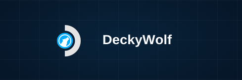

# DeckyWolf 🐺🎮

<p align="center">
  
</p>

<p align="center">
  <b>Yksityisyyttä kunnioittava selain, joka on räätälöity erityisesti Steam Deckille (SteamOS ja Linux-käsikonsolit).</b>
</p>

<p align="center">
  <a href="../README.md">English</a> •
  <a href="README.ru.md">Русский</a> •
  <a href="README.be.md">Беларуская</a> •
  <a href="README.uk.md">Українська</a> •
  <a href="README.pl.md">Polski</a> •
  <a href="README.kk.md">Қазақша</a> •
  <a href="README.uz.md">O'zbekcha</a> •
  <a href="README.az.md">Azərbaycan</a> •
  <a href="README.hy.md">Հայերեն</a> •
  <a href="README.ky.md">Кыргызча</a> •
  <a href="README.tg.md">Тоҷикӣ</a> •
  <a href="README.sr.md">Српски</a> •
  <b>Suomi</b> •
  <a href="README.lt.md">Lietuvių</a> •
  <a href="README.lv.md">Latviešu</a> •
  <a href="README.et.md">Eesti</a>
</p>

---

**DeckyWolf** on optimoitu **LibreWolf**-selaimen versio, joka on luotu erityisesti **Steam Deck** -käsikonsolille.

### Pääominaisuudet
- 🎮 **Täysi ohjaintuki**: Sauvat, ristiohjain (D-pad), toimintonäppäimet, liipaisimet ja takaläpät (L4, L5, R4, R5).
- 🔄 **Ympyrävieritys vasemmalla kosketuslevyllä haptisella palautteella**: Sivujen vieritys kosketuslevyä kiertämällä ja hiiren keskipainikkeen klikkaus painamalla.
- 🔀 **Ohjaustilan vaihtopainike**: Nopea vaihto "Ohjain"- ja "Näppäimistö + hiiri" -tilojen välillä.
- 💡 **Visuaaliset painikevihjeet**: Selkeät painikekuvakkeet näytöllä (Xbox-, PlayStation- ja Steam Deck -tyylit).
- ⚙️ **"Ohjain"-osio asetuksissa**: Mukauta herkkyyttä ja painikkeita osoitteessa `about:preferences#controller`.

### Asennus
Lataa `deckywolf.AppImage` [Releases](https://github.com/Kowalski-coder/DeckyWolf/releases) -osiosta, anna suoritusoikeudet ja käynnistä:
```bash
chmod +x deckywolf.AppImage
./deckywolf.AppImage
```

---

## ☕ Support the Project / Поддержка проекта

<p align="center">
  <a href="https://boosty.to/kowalski1997/donate">
    
  </a>
</p>

<p align="center">
  👉 <b><a href="https://boosty.to/kowalski1997/donate">Поддержать автора на Boosty (Donate)</a></b> 🧡
</p>
